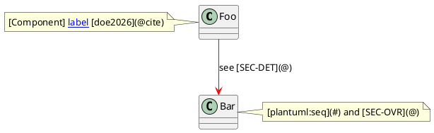
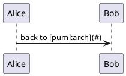

# PlantUML Diagram Links @SPEC-OUT-013

## Overview @SEC-OVR

Body links to the same targets: [SEC-DET](@), [SEC-OVR](@), [puml:seq](#)
and [plantuml:seq](#).

## Details @SEC-DET

Details section.

