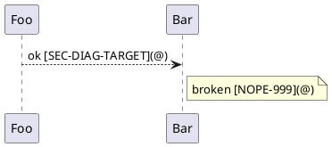

# Unresolved Diagram Links @SVC-VERIFY-DIAGRAM-LINKS

A CommonSpec link inside a PlantUML diagram is diagnosed like a body link:
an unresolved target raises `unresolved_relation` at the exact source line.

> version: 1.0

## Section: Diagram With Links @SEC-DIAG-LINKS

## Section: Diagram Link Target @SEC-DIAG-TARGET

Control body link (resolves): [SEC-DIAG-LINKS](@).
